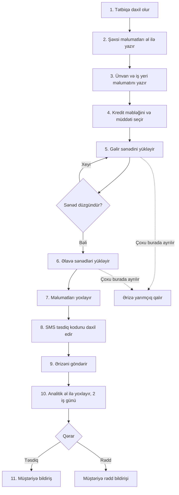
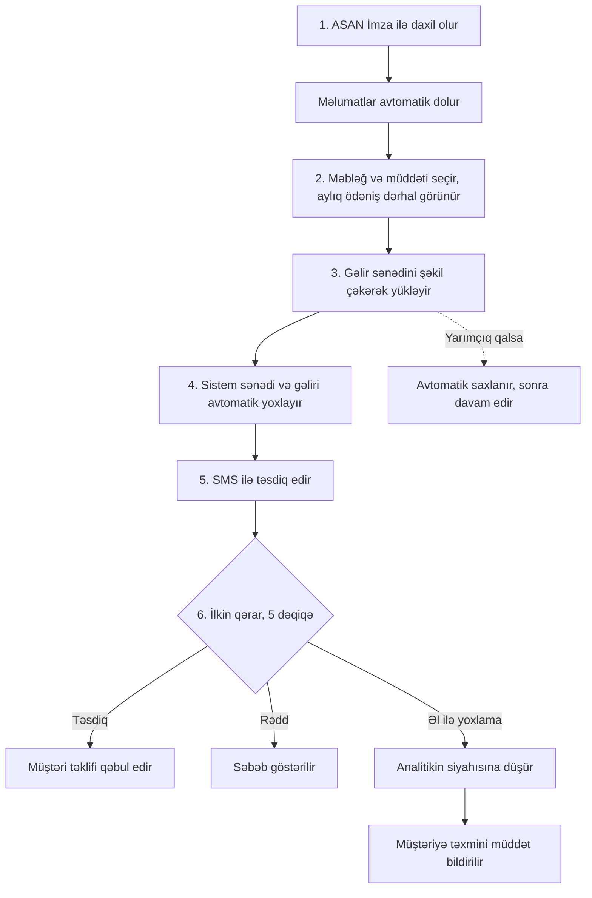

# 04. Proseslər

GitHub bu diaqramları avtomatik çəkir (Mermaid).

## AS-IS: hazırkı proses
Müştəri ərizəni 11 addımda tamamlamalıdır, orta müddət 18 dəqiqədir.

### AS-IS-də problemlər
| Addım | Problem |
|---|---|
| 2-3 | Məlumatlar əl ilə yazılır, vaxt aparır və səhv riski var |
| 5-6 | Sənəd yükləmə mürəkkəbdir, səhv olsa təkrar yükləmək lazım gəlir |
| 10 | Qərar 2 iş günü çəkir, müştəri gözləyir |
| Ümumi | Yarımçıq saxlanan ərizəyə sonra qayıtmaq mümkün deyil |

## TO-BE: təklif olunan proses
Müştəri ərizəni 6 addımda tamamlayır, hədəf müddət 8 dəqiqədir.

## Əsas fərqlər
| Göstərici | AS-IS | TO-BE |
|---|---|---|
| Addım sayı | 11 | 6 |
| Orta müddət | 18 dəqiqə | 8 dəqiqə |
| Qərar müddəti | 2 iş günü | 5 dəqiqə (ilkin) |
| Məlumat daxil etmə | Əl ilə | ASAN İmza ilə avtomatik |
| Yarımçıq ərizə | İtirilir | Saxlanılır |