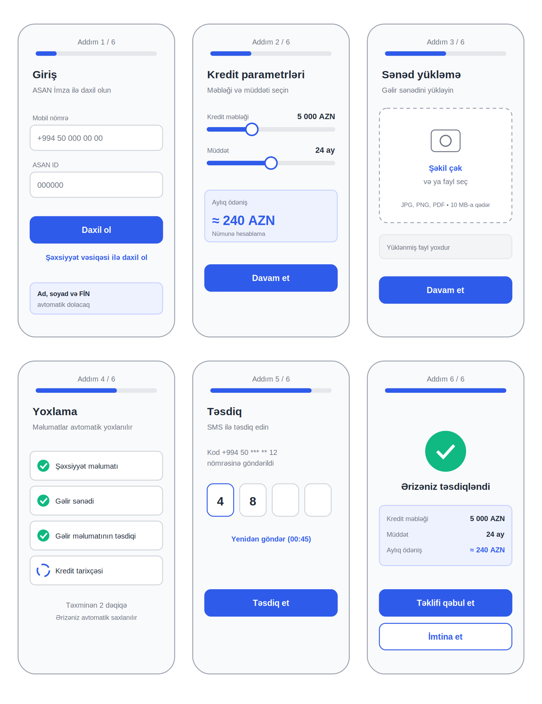

# 06. Wireframe

TO-BE prosesinin ([04-prosesler](../04-prosesler)) 6 addımı üçün sadə (low-fidelity) ekran eskizləri. Məqsəd dizayn göstərmək yox, tələblərin ([03-telebler](../03-telebler)) ekranda necə görünəcəyini göstərməkdir.

## Ekranlar və tələblər
| Ekran | Nə göstərir | Əlaqəli tələb |
|---|---|---|
| 1. Giriş | ASAN İmza və ya şəxsiyyət vəsiqəsi ilə giriş, məlumatlar avtomatik dolur | FR-01, FR-02, US-01 |
| 2. Kredit parametrləri | Məbləğ və müddət seçimi, aylıq ödəniş dərhal görünür | FR-03 |
| 3. Sənəd yükləmə | Şəkil çəkmək və ya fayl seçmək, format və ölçü haqqında məlumat | FR-04, US-02 |
| 4. Yoxlama | Məlumatlar avtomatik yoxlanılır, müştəri prosesi izləyir | FR-05, FR-06 |
| 5. Təsdiq | SMS kodu ilə təsdiq | NFR-02 |
| 6. Qərar | Nəticə və təklifin şərtləri | FR-06, US-04 |

## Dizayn qərarları
Qərarlar [05-melumat-analizi](../05-melumat-analizi) bölməsindəki nəticələrə əsaslanır.

- **Üstdə addım göstəricisi (1/6).** Müştəri prosesin neçə addım olduğunu və hara çatdığını görür. AS-IS-də 11 addım var idi və müştəri nə qədər qaldığını bilmirdi.
- **Ayrı ekranda yalnız bir sənəd.** Yarımçıq qalan ərizələrin 50.5%-i 5-ci və 6-cı addımda, yəni sənəd yükləmədə ayrılırdı. Ona görə TO-BE-də tək gəlir sənədi istənir, əlavə sənədlər sistem tərəfindən avtomatik yoxlanır.
- **Telefonla şəkil çəkmək.** Ayrıca fayl axtarmağa ehtiyac qalmır.
- **Aylıq ödəniş dərhal görünür.** Müştəri qərar verməzdən əvvəl şərtləri bilir.
- **Yoxlama ekranı.** Avtomatik yoxlama gedərkən müştəri nəyin yoxlandığını görür və gözləmə anlaşılan olur.

## Digər variantlar (eskizi çəkilməyib)
Qərar ekranı üç hala bölünür:
- **Təsdiq:** yuxarıdakı ekran
- **Rədd:** səbəb qısa izah olunur, müştəriyə sonrakı addım təklif edilir
- **Əl ilə yoxlama:** "Ərizəniz yoxlanılır" mesajı və təxmini müddət göstərilir (US-04)

> Qeyd: Ekranlar konsepsiyanı göstərmək üçün hazırlanıb. Rəqəmlər (5 000 AZN, 24 ay, 240 AZN) nümunədir.
